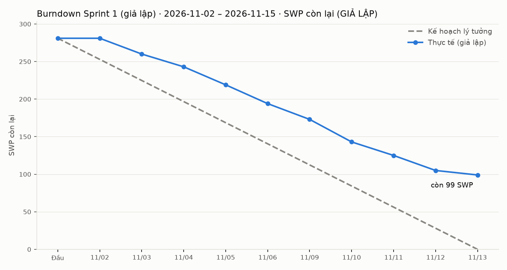

# Progress Report — Sprint 1 (GIẢ LẬP)

> **Toàn bộ tiến độ trong file này là giả lập.** Bài thực hiện ngày **2026-10-30**, trước khi Sprint 1 bắt đầu; trạng thái cuối
> Sprint 1 do kịch bản `progress-data/sprint1.yaml` đặt và được ghi lên Project #2 bằng `tools/simulate-sprint.py`. Người phụ trách
> (担当(仮)) là người giả định. Bảng số liệu dưới đây do script **đọc từ Project bằng API** rồi điền vào file (không gõ tay).

## 1. Iteration

- Iteration trên Project: **`Sprint 1 (giả lập)`** — 2026-11-02 〜 2026-11-15 (14 ngày, 10 ngày làm việc 11-02〜11-06, 11-09〜11-13).
- Thời điểm báo cáo: cuối Sprint 1 giả lập (sau ngày làm việc 2026-11-13). Phạm vi: các item lá có Iteration = Sprint 1 trên Project;
  issue cha / epic không cộng vào bảng (SWP cha = tổng con, cộng sẽ đếm hai lần) — Status của cha cộng dồn từ con.

## 2. Trạng thái

**Kết luận: Sprint 1 KHÔNG đạt kế hoạch** — Done 20 / 29 item, 182 / 281 SWP (64.8%); 9 item carry-over (99 SWP, 87.5h) làm Sprint 2
vượt trần ngay từ đầu (bảng tải Sprint 2 dưới đây).

Item lá trong Iteration Sprint 1, đọc từ Project #2 (trường Status, SWP, 見積時間) và trạng thái issue (open / closed):

<!-- sprint-sim:status -->
| Trạng thái | Số issue | Tổng SWP | Ghi chú |
|---|---|---|---|
| Done | 20 | 182 | 155.5h · issue đã đóng 20 / 20 |
| In Review | 3 | 28 | 40h · carry-over: #166, #179, #220 |
| In Progress | 5 | 46 | 39.5h · carry-over: #146, #158, #180, #225, #243 |
| Todo | 1 | 25 | 8h · carry-over: #244 |
| **Tổng Sprint 1** | **29** | **281** | 243h · hoàn thành 20 / 29 item (69%), 182 / 281 SWP (64.8%) |
<!-- /sprint-sim:status -->

Theo 担当(仮) (giờ = trường 見積時間 trên Project):

<!-- sprint-sim:owner -->
| 担当(仮) | Giờ kế hoạch | Giờ Done | Tỷ lệ Done | Item chưa Done |
|---|---|---|---|---|
| BE-A | 52 | 46 | 88% | #146 (In Progress) |
| BE-B | 52.5 | 27.5 | 52% | #179 (In Review), #180 (In Progress) |
| FE-A | 43.5 | 28.5 | 66% | #220 (In Review) |
| FE-B | 48 | 35.5 | 74% | #225 (In Progress) |
| PM | 29 | 18 | 62% | #158 (In Progress), #166 (In Review) |
| QA-A | 18 | 0 | 0% | #243 (In Progress), #244 (Todo) |
<!-- /sprint-sim:owner -->

- **Carry-over sang Sprint 2 (9 item):** BE #146, #179, #180 (BE xếp sát trần + review DB dồn vào BE-A) · FE #220 (review trả lại),
  #225 (FE-B mất thời gian dựng môi trường production) · QA #243 (chờ môi trường, việc thêm do giới hạn Supabase), #244 (chờ dữ liệu +
  kịch bản của #243) · PM #158 (khách chưa trả lời 要確認), #166 (chờ PL duyệt thiết kế D33). Lý do từng item: `progress-data/sprint1.yaml`.
- **Item bị chặn bởi carry-over** (phụ thuộc trong `tools/backlog.yaml`): Sprint 2 — #182, #183 (cần #179, #180); Sprint 3 — #188, #189
  (qua #182, #183), #234, #235 (cần #243, #244); backlog — #146 chặn trực tiếp 12 item gồm **#226 RLS / REVOKE (ADR-004)**, #166 chặn
  cài đặt D33 (#214〜#216) và SCR-21 (#168〜#170), #158 chặn #195, #196, #220 chặn #261.
- Item Done đã đóng issue; SWP của issue đã đóng giữ nguyên giá trị đã review (script không ghi trường SWP).

**Tải Sprint 2 nếu nhận nguyên carry-over** (giờ đã xếp Iteration Sprint 2 trên Project + giờ item Sprint 1 chưa Done):

<!-- sprint-sim:sprint2 -->
| 担当(仮) | Sprint 2 (giả lập): đã xếp (h) | + carry-over Sprint 1 (h) | = Tổng (h) | Trần (h) | Vượt (h) |
|---|---|---|---|---|---|
| FE-A | 45 | 15 | 60 | 52.5 | 7.5 |
| FE-B | 52 | 12.5 | 64.5 | 52.5 | 12 |
| BE-A | 50 | 6 | 56 | 52.5 | 3.5 |
| BE-B | 51 | 25 | 76 | 52.5 | 23.5 |
| QA-A | 18 | 18 | 36 | 52.5 | — |
| PM | 16 | 11 | 27 | 30 | — |
| **Tổng** | 232 | 87.5 | **319.5** | 292.5 | 46.5 (ròng 27) |
<!-- /sprint-sim:sprint2 -->

Nếu rút sang Sprint 3 các item đề xuất ở §4 (`sprint1.yaml` → `replan_push_to_sprint3`), Sprint 3 cũng vượt trần — quá tải chỉ dời đi:

<!-- sprint-sim:sprint3 -->
| 担当(仮) | Sprint 3 (giả lập): đã xếp (h) | + rút từ Sprint 2 (đề xuất) (h) | = Tổng (h) | Trần (h) | Vượt (h) |
|---|---|---|---|---|---|
| FE-A | 48 | 10 | 58 | 52.5 | 5.5 |
| FE-B | 45 | 16 | 61 | 52.5 | 8.5 |
| BE-A | 50 | 10 | 60 | 52.5 | 7.5 |
| BE-B | 52.5 | 6 | 58.5 | 52.5 | 6 |
| QA-A | 50 | 0 | 50 | 52.5 | — |
| PM | 4 | 0 | 4 | 30 | — |
| **Tổng** | 249.5 | 42 | **291.5** | 292.5 | 27.5 (ròng -1) |
<!-- /sprint-sim:sprint3 -->

Cột "Vượt" dòng Tổng = cộng phần vượt từng người; "ròng" = tổng giờ − tổng trần (QA-A, PM còn dư nhưng không làm thay việc BE / FE).
**Ảnh hưởng mốc:** carry-over 87.5h ≈ 0.3 sprint năng lực cả đội (trần 292.5h / sprint) — là mức lùi **tối đa** của mốc hoàn tất
backlog nếu không thêm người và không ai làm nhanh hơn ước. Gộp Sprint 2–3, phần vượt ròng là 27h (Sprint 2) và −1h (Sprint 3): phần
FE / BE-A còn rút được, nhưng **phần vượt cuối cùng nằm ở BE-B (23.5h ở Sprint 2)** vì các item BE-B còn lại đều có item phụ thuộc →
một chuỗi BE-B phải lùi ra sau Sprint 3 (lùi mốc thực tế nằm giữa ~0.1 và 0.3 sprint, dồn vào BE).

## 3. Burndown

SWP còn lại cuối mỗi ngày làm việc. Kế hoạch lý tưởng: giảm đều từ tổng SWP Sprint 1 về 0 trong 10 ngày. Thực tế: SWP của item
**Done** (qua review) mới được trừ. Dữ liệu: `progress-data/burndown-sprint1.csv`.

<!-- sprint-sim:burndown -->
| Ngày | Kế hoạch lý tưởng (SWP còn) | Thực tế giả lập (SWP còn) | Lệch | SWP xong trong ngày |
|---|---|---|---|---|
| đầu sprint | 281 | 281 | +0.0 | 0 |
| 2026-11-02 | 252.9 | 281 | +28.1 | 0 |
| 2026-11-03 | 224.8 | 260 | +35.2 | 21 |
| 2026-11-04 | 196.7 | 243 | +46.3 | 17 |
| 2026-11-05 | 168.6 | 219 | +50.4 | 24 |
| 2026-11-06 | 140.5 | 194 | +53.5 | 25 |
| 2026-11-09 | 112.4 | 173 | +60.6 | 21 |
| 2026-11-10 | 84.3 | 143 | +58.7 | 30 |
| 2026-11-11 | 56.2 | 125 | +68.8 | 18 |
| 2026-11-12 | 28.1 | 105 | +76.9 | 20 |
| 2026-11-13 | 0 | 99 | +99.0 | 6 |
<!-- /sprint-sim:burndown -->

**Thực tế lệch kế hoạch ở đâu, vì sao:**
- **Ngày 1 (11-02) không trừ được gì:** item đầu sprint đều kéo dài 1–2 ngày và chỉ tính khi qua review.
- **Ngày 2–5 tụt dần** (lệch tăng mỗi ngày, không ngày nào đuổi kịp kế hoạch); #14 (dựng môi trường production) trễ 2 ngày: giới hạn
  Supabase (không chọn được region backup, không có region Osaka) phải xác minh và ghi lại cho DR — việc thêm ngoài giờ ước. #15, #132,
  #243 phụ thuộc #14 nên dịch theo.
- **Ngày 6–10 khoảng cách tiếp tục mở rộng** (chỉ 11-10 thu hẹp nhẹ khi 3 item xong cùng ngày): BE-A / BE-B xếp sát trần không có dư,
  review DB dồn vào BE-A → #179 chờ review, #180 và #146 bắt đầu muộn; #220 bị review trả lại; #166 chờ PL duyệt.
- **Phần còn lại tập trung:** 3 item #244, #166, #243 giữ 56 / 99 SWP còn lại (57%) — chuỗi chuẩn bị load test (điều kiện ADR-010)
  và thiết kế D33. Cuối sprint còn 99 / 281 SWP (35.2%); tỷ lệ Done theo SWP gần bằng theo giờ (bảng §2) → lệch chủ yếu do chờ
  (review, phụ thuộc, trả lời khách) và việc phát sinh ngoài ước (#14, #243).

## 4. Rủi ro trễ

| Rủi ro | Issue | Ảnh hưởng tới mốc nào | Hành động | Ai làm, khi nào |
|---|---|---|---|---|
| **Sprint 2 vượt trần ngay từ đầu** vì carry-over (bảng tải Sprint 2 §2): BE-B, FE-B, FE-A, BE-A đều vượt; rút sang Sprint 3 thì Sprint 3 vượt (bảng tải Sprint 3 §2) | 9 item carry-over; Sprint 2–3 của 4 người trên | Mốc Sprint 2–3; mốc hoàn tất backlog lùi ≥ ~0.3 sprint nếu không thêm người | Sprint 2 planning rút phần vượt sang Sprint 3, ưu tiên item không có item phụ thuộc trong Sprint 2: FE-A #12, FE-B #264 + #31, BE-A #222, BE-B #67. **Giữ** #230, #231, #243, #244 (chuỗi ADR-010). BE-B vẫn vượt vì #7, #8, #29, #60 đều có item phụ thuộc trong Sprint 2 → phải lùi một chuỗi, PM chọn và báo PL. Xếp lại Sprint 2–3 cùng lúc (không chỉ dời sang Sprint 3); phần không hấp thụ được đưa ra sau Sprint 3 và báo PL mức lùi mốc — là dữ liệu cho quyết định thêm BE | PM — Sprint 2 planning 2026-11-13 |
| **BE quá tải / nút cổ chai** — BE-A / BE-B xếp 99–100% trần (không dư); Sprint 1 BE-B chỉ Done 52% giờ kế hoạch, BE-A 88%; review DB dồn vào BE-A | #146, #179, #180; chặn #182, #183 (Sprint 2), #188, #189 (Sprint 3), #226 | Sprint 2–3 (E09 soạn version); mốc hoàn tất backlog (BE-A 543h + BE-B 553h toàn backlog, `task-breakdown.md` §1.3) | (1) Review DB luân phiên BE-A / BE-B, hạn review 1 ngày. (2) **Có điều kiện:** velocity BE Sprint 1–2 thấp hơn kế hoạch thì **thêm 1 BE từ Sprint 4** (bắt đầu 2026-12-14). Sprint 1 đã chạm điều kiện → quyết cuối Sprint 2 để còn 2 tuần tìm người + bàn giao; nếu Sprint 2 cũng thấp, đề nghị PL quyết sớm hơn | PM đề xuất, PL quyết — cuối Sprint 2 (2026-11-27) |
| **Ước có thể thiếu** — thấp hơn LAB-1 25.4% cùng phạm vi (552.2 → 412.2 MD, `estimate.md` §5); Sprint 1 có việc phát sinh ngoài ước (#14, #243); chuỗi DR / load test có giờ / SWP thấp nhất (vd. #244 8h cho 25 SWP) và #241 ghi rõ kết quả bất định | toàn backlog; #243, #244, #234, #241 | Mốc hoàn tất backlog; quyết định B′ / B | Ước lại #243, #244, #234, #241 ở Sprint 2 planning (cộng việc sao chép backup ra ngoài). Từ Sprint 2 ghi giờ thực tế từng item; retro so thực tế / ước — lệch lớn (ngưỡng PM đề xuất 25%, chờ PL duyệt) thì ước lại phần còn lại, báo PL, dùng LAB-1 làm cận trên. Sprint 1 giả lập không có giờ thực tế → chưa kết luận | PM — 2026-11-13 ước lại; retro Sprint 2 (2026-11-27) |
| **Issue 要確認 chưa có trả lời** — khách chưa định nghĩa 「次期」 | #158 → #195, #196 (#159) | Delta 完納奨励金 (logic tiền, Constraint 完納奨励金) | Nhắc khách, hạn mới 2026-11-20; quá hạn thì làm theo giả định nội bộ PREMISE P2-3, **báo khách giả định và xin xác nhận lại**, ghi rõ trong #158 | PM — 2026-11-16 nhắc, 2026-11-20 chốt |
| **Điều kiện ADR-010 chưa đo, quyết định B′ / B có thể trễ** — B′ cần đo dump + sao chép < 15 phút lúc tải cao điểm; #234 cần #243, #244 (carry-over) **và** I-075 (#230, #231 của FE-B ở Sprint 2, FE-B đã vượt trần); giới hạn Supabase thêm bước sao chép backup ra ngoài | #243, #244, #230, #231 → #233 / #234, #235; #241 | Quyết định B′ / B (cuối Sprint 3, 2026-12-11) có thể lùi sang Sprint 4 → cam kết NFR-AVL-03 với khách chưa chốt được | Giữ #230, #231, #243, #244 trong Sprint 2 (không rút); nếu một item trễ thì báo PL ở Sprint 3 planning, dời ngày quyết định và báo khách trước khi cam kết NFR-AVL-03; đo không đạt thì lùi B, gửi câu hỏi khách đã duyệt (`open_questions` #1) | QA-A đo; PM theo dõi chuỗi, PL quyết B′ / B — 2026-11-27 xem lại, 2026-12-11 quyết |
| **Thiếu test tích hợp cho màn 概算** — 17 màn ước thô chưa có 画面設計, Iteration trống; luồng #384, #387 chỉ là 概算 | #384, #387; 17 issue màn ước thô (`task-breakdown.md` §2) | Mốc 結合テスト theo luồng nghiệp vụ; mốc hoàn tất | Xếp 画面設計 của các màn mà #384 / #387 dùng vào Sprint 3–4; ước lại #384 / #387 ngay sau thiết kế; chưa có thiết kế thì không đưa luồng vào sprint | PM — Sprint 3 planning (2026-11-27) |
| **Thiết kế bổ sung chờ PL duyệt** | #166 → cài đặt D33 (#214〜#216), SCR-21 (#168〜#170), test #383 | Cài đặt D33 (調整要求 cho 支払実績) | PL duyệt #166 tuần 1 Sprint 2; thiết kế #131, #142 đã được PL duyệt trong Sprint 1 (`sprint1.yaml`) | PL — trước 2026-11-20 |

> **Ghi chú nội bộ (không gửi khách):** trước khi gửi phụ lục dưới đây, PL xác nhận có công bố giới hạn region backup (gạch đầu dòng
> thứ 3 của phụ lục) cho khách hay không.

## Phụ lục — お客様向けサマリー（JA）

> 本サマリーは**模擬スプリント**（2026-11-02〜11-15、計画演習として 2026-10-30 に作成）の結果であり、実際の進捗ではありません。

- 第1スプリント（模擬）では、計画項目の約7割（件数ベース）が完了しました。主なものは主要テーブル、本番環境の構築、共通エラー処理の一部です。
- 二要素認証（OTP）の画面・機能は第2スプリントで対応します。承認待ちの設計、レビュー中のデータベース変更、負荷試験の準備は第2スプリントに持ち越します。
- 本番環境構築の際、バックアップ保管リージョンの制約（大阪リージョンなし）を確認しました。災害復旧方式の判断に影響するため、負荷試験時の計測を優先します。判断時期が後ろ倒しになる場合は、事前にご報告します。
- 「次期」の定義に関するご確認事項について、ご回答をお待ちしております。11/20 までにご回答がない場合は、弊社の想定案で作業を進め、その内容を改めてご確認いただきます。
- 第2スプリントでは持ち越し項目を優先して完了させ、全体スケジュールへの影響を最小化します。
